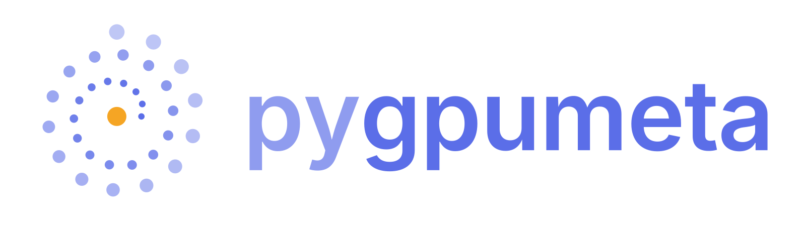

<p align="center">
  
</p>

# pygpumeta

GPU metaheuristics for continuous optimisation with large populations,
built around selection operators that work at the level of GPU warps.

## What it is for

Problems where a population of hundreds to tens of thousands of candidates
is evaluated at once and the objective can be computed for the whole
population on the GPU: fitting model parameters to data, synthesising
antenna arrays and filters, sizing structures, dispatching generators,
thresholding images. You describe the objective as a Python function on GPU
arrays; you do not write CUDA code.

- Eight algorithms: ABC, GWO, WOA, SCA, SSA and HHO as CUDA kernels, PSO
  and DE as array code.
- Three warp-level selection operators (tournament, Ballot-Elite,
  migration), usable inside the algorithms or on their own.
- Box bounds per variable, inequality and equality constraints, integer and
  categorical variables, minimisation or maximisation.
- Reproducible runs for a given seed, step-wise control, callbacks and
  stopping rules.

## What it is not for

- **Objectives that must run on the CPU.** They are supported
  (`mode="host"`), but then only the bookkeeping runs on the GPU and there
  is no speedup to expect over a CPU optimizer.
- **Small populations.** A GPU pays off when there is a lot to do in
  parallel.
- Multi-objective optimisation, multiple GPUs and GPUs other than NVIDIA's
  are outside its scope.

## Installation

An NVIDIA GPU, the CUDA toolkit, a C++ compiler and PyCUDA are required;
CuPy is needed for objectives written as Python functions on GPU arrays.
[docs/installation.md](https://github.com/EmreCanKURAN/pygpumeta-dev/blob/main/docs/installation.md) has step-by-step instructions
for Google Colab, Linux with conda-forge and Windows. Afterwards,

```
python -m pygpumeta.doctor
```

checks every component, says how to fix what is missing and finishes with a
small optimisation run.

## Quick start

```python
import pygpumeta

def objective(x):                 # x: cupy.ndarray of shape (n, 30), on the GPU
    return ((x - 1.0) ** 2).sum(axis=1)

result = pygpumeta.minimize(
    objective, (-5.0, 5.0), dim=30, algorithm="gwo", pop_size=1024, max_iter=1000, seed=0,
)
print(result.fun, result.x, result.nfev, result.runtime, result.termination)
```

With constraints and mixed variables:

```python
from pygpumeta import Constraint, minimize
from pygpumeta.space import Categorical, Integer, Real

result = minimize(
    objective,
    [Real(-1.0, 1.0), Integer(0, 10), Categorical(["a", "b", "c"])],
    constraints=[Constraint(lambda x: x[:, 0] + x[:, 1] - 5.0)],   # x0 + x1 <= 5
    constraint_handling="feasibility",
)
print(result.values, result.feasible)
```

## Documentation

- [Which objective mode should I use?](https://github.com/EmreCanKURAN/pygpumeta-dev/blob/main/docs/objective_modes.md), with
  measured timings of one problem in each mode.
- [The selection operators](https://github.com/EmreCanKURAN/pygpumeta-dev/blob/main/docs/selection.md): what they do and what they
  do not provide.
- [Adding an algorithm](https://github.com/EmreCanKURAN/pygpumeta-dev/blob/main/docs/adding_an_algorithm.md).
- [Installation](https://github.com/EmreCanKURAN/pygpumeta-dev/blob/main/docs/installation.md).
- [Examples](https://github.com/EmreCanKURAN/pygpumeta-dev/blob/main/docs/examples.md) with their results: antenna array synthesis,
  solar cell parameter extraction, truss sizing, economic load dispatch,
  image thresholding, FIR filter design, SVM tuning and a custom algorithm.

Every public function and class has a docstring; `help(pygpumeta.minimize)`
is the reference for the main entry point.

## Tests

Install the package together with its test dependencies (pytest,
hypothesis, pytest-cov), which a plain `pip install -e .` leaves out:

```
pip install -e ".[test]"
pip install scipy scikit-learn    # optional: the tests of the examples
```

```
python -m pytest -m "not gpu"     # CPU tier, anywhere
python -m pytest -m gpu           # GPU tier, on a machine with a CUDA device
python -m pytest                  # both; the GPU tier is skipped without CUDA
```

On a machine without the CUDA toolkit, PyCUDA cannot be built; use
`pip install --no-deps -e .` followed by `pip install numpy pytest hypothesis`
there. `pip install -e ".[dev]"` adds ruff, mypy and pre-commit.

`notebooks/gpu_tests.ipynb` runs the GPU tier on Google Colab.

## Citation

If you use the library, please cite the paper that introduces the selection
operators:

```bibtex
@article{kuran2026warpselection,
  author  = {Kuran, Emre Can and Kuran, Umut and Ecemi{\c{s}}, Ece},
  title   = {Register-Level Selection via Warp Primitives: Shuffle-Based Tournament and
             Ballot-Elite Mechanisms for {GPU}-Accelerated Metaheuristics},
  journal = {Swarm and Evolutionary Computation},
  year    = {2026},
  doi     = {10.1016/j.swevo.2026.102633}
}
```

## Acknowledgement

This library extends the code of the paper into a general-purpose
package. It was developed with the assistance of Claude Code
(Anthropic); the authors have written the original code (paper), reviewed the design, ran the GPU test suite
and are responsible for the released code.

## License

MIT, see `LICENSE`.
